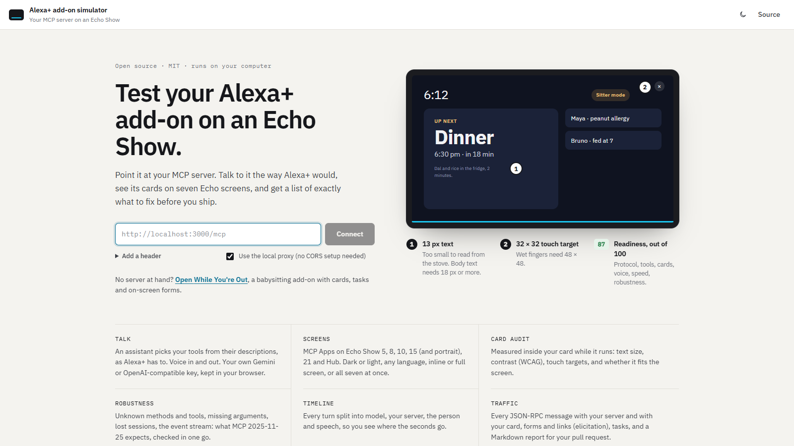
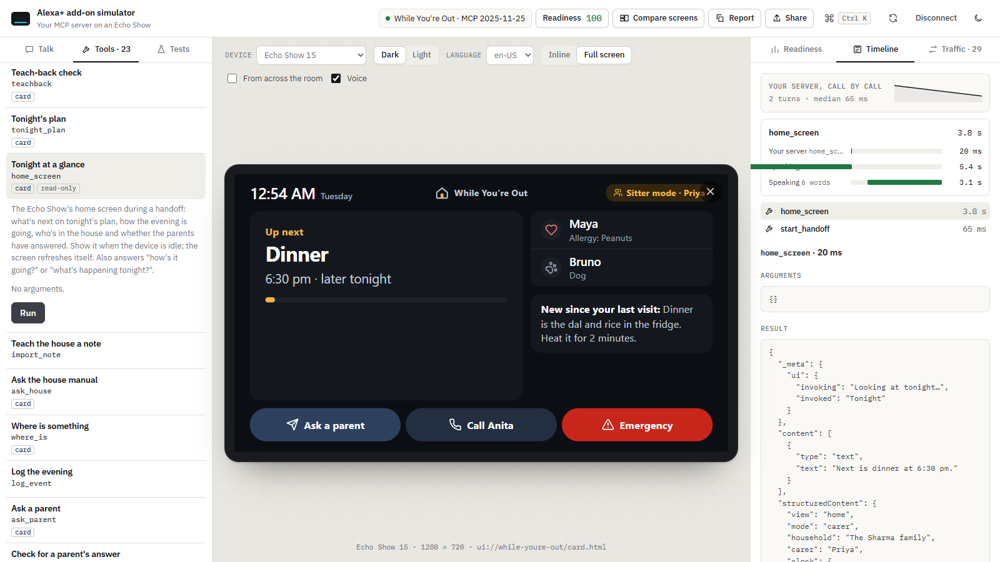
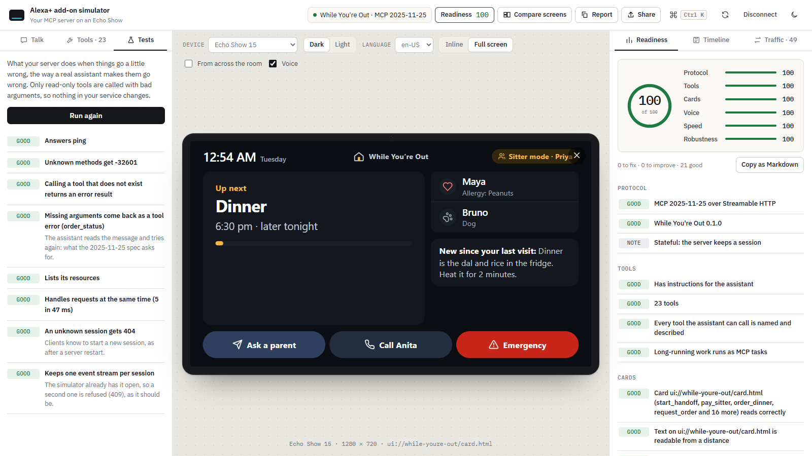
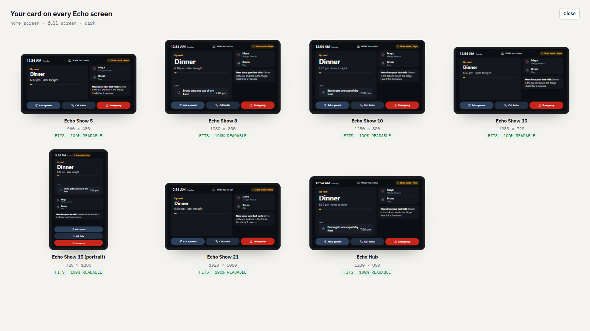

<div align="center">



# Alexa+ add-on simulator

**See your MCP server on an Echo Show before Alexa+ does.** Talk to it the way Alexa+ would, watch its MCP Apps cards on every Echo screen, and get a readiness score that tells you exactly what to fix.


[](LICENSE)
[](https://github.com/marketplace/actions/alexa-add-on-readiness)

</div>

Alexa+ add-ons are MCP servers, and there is no way yet to run one on a real Alexa+ device: the add-on console says "Coming Soon". This simulator plays Alexa+'s part on your computer. An assistant picks your tools from their descriptions, an Echo Show renders your cards, and forms and links appear when your server asks the person something. A report covers everything an add-on should get right.

## Quick start

```bash
git clone https://github.com/murthyroshan/alexa-addon-simulator
cd alexa-addon-simulator
npm install && npm run build && npm start     # http://127.0.0.1:5174
```

Paste your server's Streamable HTTP URL (for example `http://localhost:8787/mcp`) and press Connect. No server at hand? *Open While You're Out* on the start page connects to a real add-on with cards, tasks and on-screen forms.

## See it

<table>
<tr>
<td colspan="2"><br><b>Your card on an Echo Show.</b> Run any tool, or just talk to it. The card renders in a sandboxed frame at the device's real size, and the timeline shows where every second went: the model, your server, the person, speech.</td>
</tr>
<tr>
<td width="50%"><br><b>Readiness, out of 100.</b> Protocol, tools, cards, voice, speed and robustness, each finding with why it matters and what to do. Copy it as Markdown for a pull request.</td>
<td width="50%"><br><b>Every Echo screen at once.</b> The same card on seven devices, each measured: does it fit, how much of the text is readable from across a kitchen.</td>
</tr>
</table>

## What it does

| | |
| --- | --- |
| **Talk to it like Alexa+** | Type or speak a sentence. An assistant chooses your tools by their names and descriptions, calls them over MCP, shows the card and speaks a short reply, with the Echo Show light bar listening, thinking and speaking. Bring your own model: Gemini, or any OpenAI-compatible endpoint (OpenAI, OpenRouter, Ollama, LM Studio). Your key stays in your browser. |
| **Your cards on real screens** | MCP Apps (`ui://` resources) in a sandboxed frame on Echo Show 5, 8, 10, 15 (landscape and portrait), 21 and Echo Hub. Switch dark or light, the language, and inline or full screen, and watch your card adapt (`ui/notifications/host-context-changed`). |
| **Compare screens** | The same card on every Echo screen at once, each measured: does it fit, how much of the text is readable, are the touch targets big enough. |
| **From across the room** | See your card the way someone at the stove sees it. |
| **A card audit inside your card** | A small script measures what your card really draws: text under 18 px, contrast below WCAG 4.5:1 (see-through layers blended correctly), touch targets under 48 px, content that doesn't fit the screen. |
| **Readiness score** | Out of 100, in six parts: Protocol, Tools, Cards, Voice, Speed, Robustness. Every finding says why it matters and what to do. Copy the report as Markdown for a pull request. |
| **Robustness tests** | ping, an unknown method (-32601), an unknown tool, missing arguments (only on read-only tools, so nothing changes), five requests at once, a lost session (404) and the event stream: what MCP 2025-11-25 expects. |
| **Forms, links and tasks** | Elicitation forms on the screen, URL elicitation as a link and QR code, and long-running tools as MCP tasks with their status. Time the person spends answering is never counted as your server's time. |
| **Timeline** | Every turn as a waterfall (the model, your server, the person, speech), and every call's server time as a sparkline. |
| **Traffic** | Every JSON-RPC message, between the simulator and your server and between your card and the simulator. |
| **Command palette** | Ctrl+K: run any tool, switch device, run the tests, copy the report. |

## In CI

The same checks run without a browser, so your add-on's readiness can fail a build:

```bash
npm run check -- https://your-addon.example/mcp --min-score 80 --report readiness.md
```

Or as a GitHub Action, with the report in the job summary:

```yaml
- uses: murthyroshan/alexa-addon-simulator@v0.1.0
  with:
    url: https://your-addon.example/mcp
    min-score: 80
    headers: |
      Authorization: Bearer ${{ secrets.ADDON_TOKEN }}
```

It covers Protocol, Tools, Speed, Robustness and what your cards declare. The card audit (text size, contrast, touch targets, fit) needs cards drawn on a screen, so it runs in the app.

## How it compares

Other builders made good tools for the same gap while Alexa+ add-ons are closed to developers. They answer different questions, and work well together:

| Tool | What it's for (from its README) | Use it with this one when |
| --- | --- | --- |
| **alexa-addon-simulator** (this) | Your MCP Apps cards on **seven Echo screen sizes** side by side, a **card audit measured inside the card** (text size after CSS zoom, contrast, touch targets, fit), a **readiness score** in six parts, robustness tests, voice with your own model key, and the same checks as a **[GitHub Action on the Marketplace](https://github.com/marketplace/actions/alexa-add-on-readiness)** | — |
| [addon-sim](https://github.com/pauleke65/addon-sim) | An assistant-side simulator: MCP Apps host, form and URL elicitation, smart display and speaker frames, Polly voice, YAML conversation scripts and an inspector | You want scripted conversations replayed headless |
| [alexa-plus-mcp-checks](https://github.com/ubmids/alexa-plus-mcp-checks) | A pytest plugin and GitHub Action for Alexa+ authentication rules (a 401 without `WWW-Authenticate`, S256, metadata) and MCP transport rules | You want the authentication checks in Python CI |
| [alexa-skill-mcp-bridge](https://github.com/KayLerch/alexa-skill-mcp-bridge) | Puts any MCP server on a physical Alexa device through an Alexa Skill and an agent on Amazon Bedrock AgentCore | You want to demo on a real device |

What only this one does: draws your cards at each Echo's real size and measures what a person at the stove would actually see, then turns that into a score your CI can fail on.

## Built for While You're Out

This simulator grew out of [While You're Out](https://github.com/murthyroshan/while-youre-out), an Alexa+ add-on that turns the kitchen Echo Show into a babysitter's guide for the evening. It was built for the Build, Ship, Shape: Amazon Developer Hackathon. With no Alexa+ host to test on, I built a stand-in for one, then made it work with any MCP server.

Running it on While You're Out found four problems, all since fixed there: tool parameters without descriptions, tools without safety hints, card text that shrank on the smallest Echo Show, and a card that shrank its text in portrait on the Echo Show 15. It works the other way too: that card is drawn on Alexa's 768-wide base canvas and zoomed for each device, which taught the card audit to measure text as drawn, after CSS `zoom`.

## The local proxy

`npm start` serves the simulator together with a small proxy on `127.0.0.1`, so it can reach MCP servers that don't allow web pages to call them (CORS). The proxy forwards only what MCP needs (`content-type`, `accept`, `authorization`, `mcp-session-id`, `mcp-protocol-version`, `last-event-id`), never cookies, and streams server-sent events straight through. It listens on this computer only.

Without the proxy (for example `npm run dev` from another origin), your server has to allow the simulator's origin.

## What the checks are, and are not

The readiness checks are this project's own checklist. They are built from the MCP specification (2025-11-25), the MCP Apps extension, WCAG contrast and touch-target guidance, and rules of thumb for voice: a reply someone can listen to (about 40 words), and no long silences (3 seconds). They are not an Amazon certification, and passing them does not mean an add-on is approved.

Screen sizes are the CSS layout sizes a card sees on each device, approximately.

## How it works

| File | What it is |
| --- | --- |
| `src/mcp.ts` | The MCP client (official TypeScript SDK, Streamable HTTP, elicitation, tasks) with traffic capture |
| `src/AppFrame.tsx` | An MCP Apps host: `ui/initialize`, tool input and result, `tools/call` from cards (visibility `app` only), `ui/message`, `ui/open-link`, display modes |
| `src/assistant.ts` | The stand-in for the Alexa+ model: function calling with Gemini or OpenAI-compatible APIs |
| `src/checks.ts`, `src/conformance.ts`, `src/probe.ts` | The readiness checks, the robustness tests and the card audit |
| `src/report.ts` | The Markdown report |
| `server/proxy.mjs`, `server/start.mjs` | The local proxy and the static server |

```bash
npm test        # the checks, the audit, the robustness tests, the assistant loop, the proxy
npm run dev     # the simulator with hot reload (and the same proxy)
```

## License

[MIT](LICENSE)
